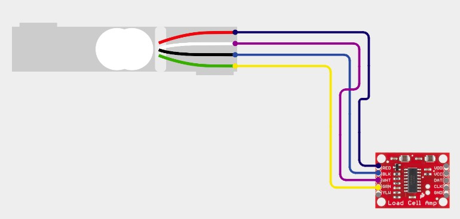

# Hydration Tracker - ECE 4180 Final Project
Created by Rohan Chadha and Auska Wang

## Table of Contents
* [The Idea](#the-idea)
* [Hardware Setup](#hardware-setup)
* [Code](#code)
* [Media](#media)

## The Idea
The Hydration Tracker is a smart water bottle scale that helps users maintain proper hydration throughout the day. The device monitors water consumption in real-time, provides visual feedback on hydration status through the onboard LED, and logs historical data for tracking progress over time.

Our goal was to create an embedded system that seamlessly integrates into daily life to promote better health habits. The tracker uses a load cell to detect when water is consumed, calculates whether the user is on track with their hydration goals, and provides intuitive feedback through the ESP32's built-in LED and speaker alerts.

The system features a WiFi-enabled web interface that allows users to view their hydration statistics, check historical consumption data, and reset their tracking data - all accessible from any device connected to the same network. A dedicated push button enables easy WiFi connectivity control, with a blue LED indicator showing the connection status.

## Hardware Setup

### Necessary Components

For the Hydration Tracker hardware, the following components are required:
* ESP32-C6-DevKitC-1 Microcontroller
* HX711 Load Cell Amplifier
* Load Cell (5kg capacity)
* Blue LED (WiFi status indicator)
* Buzzer
* Battery Pack (for portable operation)
* Breadboard
* 330Ω Resistor (for RGB LED)

### Wiring

| ESP32-C6 Pin | HX711 | Blue LED| Speaker | Push Button | Power |
| :----------: | :---: | :-----: | :-----: | :---------: | :---: |
| 5V           | VCC   |         |         |             |   +   | 
| GND          | GND   | Cathode |    -    |     GND     |   -   |
| GPIO 4       |       |  Anode  |         |             |       |
| GPIO 5       |       |         |         |   Signal    |       |
| GPIO 6       | DAT   |         |         |             |       |
| GPIO 7       | CLK   |         |         |             |       |
| GPIO 21      |       |         |    +    |             |       |

**Load Cell Wiring:**
### 

- E+ → RED
- E- → BLK
- A- → WHT
- A+ → GRN

### Assembly Notes

The load cell should be mounted in a stable configuration to accurately measure the weight of the water bottle. We recommend:
1. Securing the load cell to a flat, rigid base
2. Creating a platform on top of the load cell for the water bottle to rest on
3. Ensuring the load cell is calibrated before first use (calibration value in `config.h`)

The blue LED serves as a WiFi status indicator:
- **Solid Blue**: WiFi connected and web server active
- **Off**: WiFi disconnected

The onboard LED provides hydration status feedback:
- **Green**: On track with hydration goals
- **Yellow**: Falling behind, should drink soon  
- **Red**: Critical, need to drink immediately

## Code

### Module Architecture

The codebase is organized into modular components, each handling a specific aspect of the system:

#### **config.h**
Central configuration file containing:
- Pin definitions for all hardware components
- Calibration values for the load cell
- Hydration goals and timing parameters
- LED state definitions for different hydration levels
- Storage configuration for historical data
- WiFi credentials and settings

#### **scale.cpp / scale.h**
Handles the HX711 load cell interface:
- Initializes the HX711 with calibration values
- Reads weight measurements with stability checking
- Calculates delta (change in weight) to detect water consumption
- Implements filtering to reduce noise

#### **hydration.cpp / hydration.h**
Manages hydration tracking logic:
- Tracks total water consumed vs. daily goal
- Calculates ideal consumption rate over time
- Determines hydration state (HYDRATED, NEEDS_WATER, CRITICAL)
- Updates status based on consumption pattern
- Provides reset functionality for new tracking periods

#### **status_led.cpp / status_led.h**
Controls the onboard LED feedback:
- Initializes the ESP32-C6 onboard LED
- Maps hydration states to LED patterns:
  - **Green**: On track with hydration
  - **Yellow**: Falling behind, should drink soon
  - **Red**: Critical, need to drink immediately
- Provides visual status at a glance

#### **speaker.cpp / speaker.h**
Manages audio alerts:
- Generates tone alerts using PWM
- Plays periodic reminders when hydration is critical
- Implements alert timing to avoid annoyance
- Can be silenced when hydration improves

#### **storage.cpp / storage.h**
Handles non-volatile memory operations:
- Stores up to 7 days of hydration history using NVS (Non-Volatile Storage)
- Saves daily consumption data with timestamps
- Provides data retrieval for web interface
- Implements reset functionality

#### **web.cpp / web.h**
Implements WiFi access point and web server:
- Creates a WiFi hotspot (SSID: "ESP32-14")
- Serves HTML page with real-time hydration data
- Provides AJAX endpoints for live updates
- Displays historical consumption in table format
- Allows users to reset tracking data
- Can be toggled on/off via push button

#### **4180.ino**
Main program file that:
- Initializes all hardware modules
- Creates FreeRTOS tasks for concurrent operation:
  - `taskReadScale`: Monitors scale for weight changes (every 100ms)
  - `taskUpdateStatusLED`: Updates onboard LED based on hydration state (every 2s)
  - `taskAlertUser`: Triggers speaker alerts when needed (every 1s)
  - `taskHTMLPage`: Handles web server requests (every 10ms)
  - `taskWiFiControl`: Manages WiFi button and blue LED status
- Manages end-of-day data logging and resets

### Library Dependencies
* [Arduino Core for ESP32-C6](https://github.com/espressif/arduino-esp32)
* [HX711 Library (for load cell interface)](https://github.com/bogde/HX711)
* [WiFi (built-in ESP32)](https://docs.arduino.cc/libraries/wifi/)
* [NVS (Non-Volatile Storage, built-in)](https://docs.espressif.com/projects/esp-idf/en/stable/esp32/api-reference/storage/nvs_flash.html)
* [FreeRTOS (built-in ESP32)](https://docs.espressif.com/projects/esp-idf/en/stable/esp32/api-reference/system/freertos.html)

### System Overview

#### Hydration Tracking Algorithm
The system uses a time-based tracking algorithm that compares actual consumption against an ideal consumption rate:

1. **Tracker Calculation**: An ideal "tracker" value decreases linearly from the daily goal to zero over the configured time period (default: 120 seconds for testing, adjustable to 24 hours for real use)

2. **State Determination**:
   - `HYDRATED` (Green): User is within 20% of ideal pace or ahead
   - `NEEDS_WATER` (Yellow): User is 20-50% behind ideal pace
   - `CRITICAL` (Red): User is more than 50% behind ideal pace

3. **Weight Detection**: When the scale detects a decrease in weight (>30g), it records the amount consumed and updates the hydration status

4. **Daily Reset**: When the tracking period ends (tracker reaches zero), the system logs the day's data to NVS and resets for a new tracking period

#### WiFi Control
The push button provides convenient WiFi management:
- **Press once**: Toggle WiFi on/off
- **Blue LED on**: WiFi active, web interface accessible
- **Blue LED off**: WiFi disabled, battery saving mode

#### RTOS Threading
The system uses FreeRTOS to run multiple concurrent tasks:

**taskReadScale** (Priority 1, 4KB stack)
- Continuously monitors the scale for weight changes
- Detects meaningful consumption events (>30g decrease)
- Updates hydration tracking when water is consumed
- Triggers daily data logging and reset when period ends
- Runs every 100ms

**taskUpdateStatusLED** (Priority 3, 2KB stack)
- Reads current hydration state
- Updates onboard LED color/pattern accordingly
- Provides immediate visual feedback
- Runs every 2 seconds

**taskAlertUser** (Priority 3, 2KB stack)
- Checks if user is in CRITICAL state
- Plays audio alert to remind user to drink
- Respects timing intervals to avoid excessive alerts
- Runs every 1 second

**taskHTMLPage** (Priority 2, 2KB stack)
- Updates web interface data (current consumption, goal, history)
- Handles incoming HTTP requests
- Serves HTML page and AJAX data endpoints
- Only active when WiFi is enabled
- Runs every 10ms for responsive web interface

**taskWiFiControl** (Priority 2, 2KB stack)
- Monitors push button for WiFi toggle requests
- Controls blue LED status indicator
- Manages WiFi connection state
- Runs every 100ms

### Web Interface

The web interface provides:
- Real-time display of daily goal
- Current consumption with live updates (1-second refresh)
- Historical table showing last 7 days of consumption vs. goals
- Reset button to clear historical data
- Accessible via any device connected to the ESP32's WiFi network (IP: 192.168.4.1)
- Can be enabled/disabled via push button to conserve power

### Customization

Key parameters can be adjusted in `config.h`:
- `DAILY_GOAL_GRAMS`: Target water consumption (default: 300g for demo)
- `TOTAL_TIME_MS`: Tracking period duration (default: 120s for demo, change to 86400000 for 24 hours)
- `SCALE_CALIBRATION_VAL`: Load cell calibration factor (must be calibrated for your specific hardware)
- `ALERT_INTERVAL`: Time between audio alerts (default: 30 seconds)
- WiFi SSID and password
- LED patterns for each hydration state

## Media

### System Overview

*Fully assembled hydration tracker with ESP32-C6, load cell, blue WiFi LED, push button, and speaker*

### Hardware Components

*Wiring diagram showing connections between ESP32-C6, HX711, and peripherals*

### LED Status Indicators

*Green onboard LED indicating good hydration status*

*Yellow onboard LED indicating user should drink soon*

*Red onboard LED indicating critical hydration status*

*Blue LED indicating WiFi is active and web interface is accessible*

### Web Interface

*Web interface showing current hydration level and 7-day history*

### Device in Use

*Water bottle positioned on the load cell platform*

*Push button for toggling WiFi connectivity*

### Demo Video

---

## Future Enhancements

Potential improvements for future versions:
- Integration with fitness tracking apps
- Customizable goals based on activity level and weather
- Mobile app for remote monitoring
- Multiple user profiles
- Advanced analytics and trends
- Solar charging for outdoor use
- Larger capacity load cells for bigger water bottles
